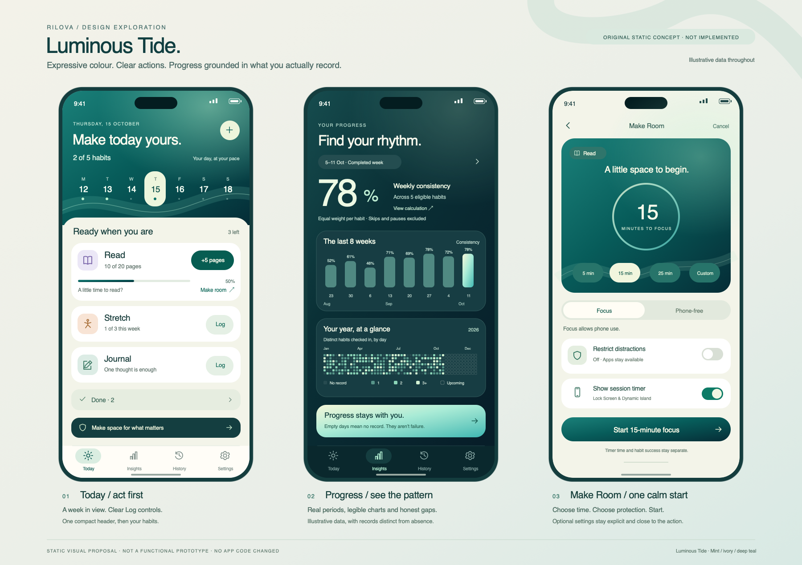

# Rilova expressive design and feature research

Reviewed October 21, 2026. Baseline: remote checkpoint `1aa1056`.

Rilova should become more visually expressive through a coordinated teal atmosphere, stronger typography, recognizable progress graphics and responsive interactions. Its main screens also need a clearer hierarchy: the first useful action and the relevant dates should appear earlier. The proposed direction is **Luminous Tide**: deep teal, aqua and pearl light, crisp reading surfaces, and an original flowing ribbon motif.

The survey covers **14 habit and routine apps plus three adjacent products**, rather than every app in the stores. Sources are official sites, publisher help, store listings and Apple design material. **Observed** describes inspected official still images; **published** describes a publisher's stated capability. Neither establishes measured usability, animation smoothness, retention or sales. Recommendations below are Rilova design judgments.

The [concept board PNG](concept-board.png) and [editable SVG](concept-board.svg) illustrate a possible direction with example data. It is a static design study, not an implemented screen or evidence of functioning controls. Competitor screenshot assets were inspected temporarily and are not included in Rilova's assets.



## What the comparison shows

| Product | Evidence from the reviewed material | Useful lesson for Rilova |
| --- | --- | --- |
| [Streaks](https://streaks.app/) | **Observed:** full-screen blue/pink gradient, very large circular targets, thick progress arcs, bold narrow labels; seasonal landscape variants. **Published:** coordinated per-page themes and animated seasonal backgrounds. [Official screenshot source](https://streaks.app/press/). | A background, progress control and typography can form one recognizable composition. Large targets help interaction; copying its entire circular layout would make long lists harder to accommodate. |
| [HabitKit](https://habitkit.app/press) | **Observed:** near-black, subtly tinted cards; luminous multicolour activity grids; prominent totals and charted progress. **Published:** alternative overview densities, count/measure tracking and interactive widgets. [Tracking setup](https://habitkit.app/help/getting-started/install-habitkit-and-create-your-first-habit). | Let recorded progress provide visual richness. Offer a compact presentation when people have many habits; keep an accessible alternative to tiny cells. |
| [Habitify](https://apps.apple.com/us/app/habitify-habit-tracker/id1111447047) | **Observed:** daily date navigation, filter pills, progress/timer rows, heatmaps and pattern reports. **Published:** multiple report ranges and weekday patterns. [Report documentation](https://intercom.help/habitify-app/en/articles/14717723-progress-screen-the-good-habits-report-mobile-app). | Put calendar navigation beside the daily actions and organize analytics into a few understandable lenses. Its current recovery messaging overlaps ours; recovery alone is not an exclusive position. |
| [Productive](https://apps.apple.com/us/app/productive-habit-tracker/id983826477) | **Observed:** charcoal surfaces, yellow primary action, illustrated template categories, date strip and time-of-day filters. **Published:** templates, quantities, timers and progress reports. | Make discovery visually inviting and keep routine groups easy to scan. Avoid importing an entire content/challenge system to achieve the appearance. |
| [Do Habits](https://apps.apple.com/us/app/do-habits-get-it-done/id1103961876) | **Observed:** pastel wide rows, quantity/target text, plus controls and progress filling the row. **Published:** repeated logs and flexible target periods. This is the original Done listing, now named Do Habits: Get It Done. | Expose an amount habit's current value and quick increment directly in its row. A colour fill needs a numerical and symbolic counterpart. |
| [Habit Tracker by InnerGrow](https://apps.apple.com/us/app/habit-tracker/id1438388363) | **Observed:** coloured habit rows, weekly date circles, quantities, a monthly grid and yearly status graphic. **Published:** period reports, Health connections, timers and widgets. | Date visibility and per-habit identity make an overview feel richer without making each action a separate screen. Its much broader feature list is not a requirement for Rilova. |
| [everyday](https://apps.apple.com/us/app/everyday-habit-tracker/id1394150432) | **Observed:** one board of habit rows against date columns, with distinct coloured chains. **Published:** cross-device access, board customization and skipping. | History can be visible beside habits instead of hidden behind several taps. The published screenshot uses an older device frame; it is a reference for the pattern, not proof of the latest runtime UI. |
| [Way of Life](https://wayoflifeapp.com/) | **Observed:** compact weekly strips, repeated across habits, and a separate notes list. **Published:** longer-term charts. [Current store listing](https://apps.apple.com/us/app/way-of-life-habit-tracker/id393159800). | A small common time axis is useful for comparing habits. Keep Rilova's neutral skip/pause/unknown states rather than adopting red/green as the entire meaning. |
| [Strides](https://www.stridesapp.com/) | **Published:** habit, target, average and project trackers; period reports and per-tracker charts. **Observed:** explicit units, date ranges and numerical comparisons in its store chart example. | Choose a visualization to match the kind of goal. Adding project management or an average tracker would be a separate product decision, not visual polish. |
| [HabitNow](https://play.google.com/store/apps/details?hl=en&id=com.habitnow) | **Published:** daily/weekly/monthly goals, calendar, timers, categories, themes and statistics. This survey uses its Android publisher listing for feature breadth. | Flexible setup and organization are useful parity references. Do not treat the Android interaction model as an iOS design specification. |
| [Loop](https://loophabits.org/) | **Observed:** a compact habit/date matrix with explicit checks and amount values in its official web screenshot. **Published:** reminders and statistics; free/open-source Android product. The site image is an older reference. | A dense overview can remain understandable when columns and units are consistent. Its older visual treatment is not the model for Rilova's brand. |
| [Finch](https://apps.apple.com/us/app/finch-self-care-pet/id1528595748) | **Observed:** coherent illustrated environments and a prominent bird, with readable habit action cards. **Published:** goals, activities and adventures. [Goal of the Day](https://help.finchcare.com/hc/en-us/articles/37780061122957-Goal-of-the-Day-Explained). | Integrate a companion into a designed environment. A user-selected priority habit is a simple option; pet-care obligations and reward currencies would change Rilova's character. |
| [Fabulous](https://apps.apple.com/us/app/fabulous-daily-habit-tracker/id1203637303) | **Observed:** large editorial lettering, illustrated sun/cloud/moon imagery and coordinated colourful panels. Several panels are marketing posters. **Published:** guided routines and journeys. | Illustrated collection covers can make templates appealing. Marketing artwork alone does not prove that an equally immersive interface is used for everyday logging. |
| [Habitica](https://apps.apple.com/us/app/habitica-gamified-taskmanager/id994882113) | **Observed:** consistent pixel art, coloured action rails, explicit plus/minus/check controls and task cards. **Published:** RPG rewards and avatars. | Consistent art direction and clear controls matter. Quests, damage and currency would add obligations rather than simplify Rilova. |
| [Gentler Streak](https://developer.apple.com/news/?id=3m0ht22s) — adjacent | **Observed:** an original mascot integrated with a broad Activity Path, prominent status and approachable charts. Apple's design article describes its approach. | Give Rilova one meaningful signature visualization. Its ribbon must describe recorded commitments, not physiological readiness. |
| [Forest](https://www.forestapp.cc/) — adjacent | **Observed:** tree-centred timer, forest scenes and focus history imagery. **Published:** growing a tree during a focus interval and accumulating a forest. | Make effort tangible over time. Rilova can preserve a visual record without withering, punishment or claims of verified focus. |
| [Structured](https://structured.app/) — adjacent | **Observed:** large date, a persistent week strip, coloured task identities and a vertical timeline with explicit completion controls. **Published:** configurable information density and motion/accessibility settings. [Customization](https://help.structured.app/en/articles/354306). | Show the week immediately and adapt density to the task. A timeline is useful for scheduled routines; it need not turn all habits into appointments. |

## What should change in Rilova

Current composition was checked against the source and saved native captures: [Today](../../../docs/verification/brand-polish/today-light.png), [Calendar](../../../docs/verification/brand-polish/calendar-light.png), [Habit detail](../../../docs/verification/brand-completion/habit-detail-light.png), [Make Room](../../../docs/verification/brand-completion/make-room-light.png) and [Insights](../../../docs/verification/brand-polish/insights-light.png). These are existing captures, not a new hardware audit.

### A coordinated visual system

Use an expressive deep-teal canvas with controlled aqua and pearl illumination. Use a small amount of periwinkle or warm gold for collection identities and occasional emphasis; these are proposed palette choices, not evidence that a colour improves adherence. Text and chart labels need stable contrast across the full gradient, both appearances and alternative themes.

Introduce a clear distinction between expressive headers, action rows and supporting controls. Vary composition instead of enclosing every section in an equally large rounded card. Give display headings and factual totals stronger typographic contrast; keep labels and body text compact and readable. Explore the existing system font's rounded and wider variants before licensing a typeface.

Apple's [brand identity guidance](https://developer.apple.com/videos/play/wwdc2026/251/) supports expressive content and familiar navigation, demonstrates Gentler Streak's use of system-font variants, and explains how purposeful transitions reinforce identity. Standard tabs, sheets and controls can coexist with distinctive content. Native familiarity does not require a plain content layout.

### Today and calendar

Combine date, one useful progress fact and a small companion presence in a compact header. Add a seven-day strip directly beneath it; expand into a month when requested. Keep the first logging actions on the initial screen at ordinary text sizes. Larger text reflows and scrolls without shrinking.

Show recorded progress in the row: a clear Log control for check-ins; a value, unit and explicit increment for quantities; a clear timer action for timed habits. Opening a row and logging remain separate actions. A compact layout can show less metadata when the list is long, without changing its behaviour.

The expanded month should lead with dates, not a giant zero-streak hero. Combine current/best/accumulated progress into a small supporting area. Selecting a past date opens a historical review; editing it remains an explicit dated correction. Future or unresolved periods must not look missed. A flexible weekly habit's outcome remains weekly.

### Habit detail and Make Room

Habit detail should lead with the habit's identity, its current action and a short history preview. Bring Log Progress and Make Room near the top. Schedule, connections and advanced settings follow them.

Make Room should feel like a session composer: habit context, existing session choice or duration, Focus/Phone-Free meaning, optional restriction row and one Start action. Keep selected-app status beside the opt-in, and disclose the exact protected/unprotected state after start. Longer explanations can expand without hiding important consent or manual-reporting meaning.

### Reports with visual purpose

Organize reporting around three questions: **How has my rhythm changed? What have I accumulated? What did I make room for?** Offer period controls and habit drill-down inside the existing Insights destination.

| Proposed visual | Question it answers | Meaning to preserve |
| --- | --- | --- |
| 8–12-week consistency chart | How have my completed weeks changed? | Clear comparable cohort/range; changed schedules or insufficient data cannot become a fabricated continuous series. |
| Monthly calendar and annual activity grid | When did I record activity? | Activity is distinct from measured adherence. Neutral skips, pauses and not-yet-tracked dates remain identifiable. |
| Quantity bars | How many pages/minutes/counts did I record? | Keep units separate; retain historical targets and expose real amounts. |
| Weekday bars | Where do my resolved opportunities fall? | Show sample counts; flexible weekly goals cannot create invented weekday misses. Current strongest/weakest text already has evidence thresholds. |
| Recovery and lifetime ribbon | What have I kept, returned to and accumulated? | Momentum remains explainable facts rather than an invented weighted score. |
| Make Room session bars | What sessions did I start and report? | Started, kept/interrupted/unreported and elapsed timer minutes are distinct from habit completion, verified focus or screen time saved. |

A chart should have a clear headline, period, units and accessible values. Put full methodology behind an accessible disclosure while leaving any essential scope beside the headline. Empty/new-user and changed-schedule states need deliberate designs. Long histories must remain responsive.

## Motion and responsiveness

The following timings are proposed starting values for a prototype, not measurements from competitors. Streaks' seasonal animation and Forest's growth are publisher-described. Apple's brand video explicitly discusses Gentler Streak's spring motion; static promotional images do not verify runtime motion.

| Moment | Proposed treatment | Interaction requirement |
| --- | --- | --- |
| Touch down | Native press feedback, approximately 80–120 ms | Immediate visible response; no waiting for decoration. |
| Saving | Pending label at the tapped control | Only canonical persistence can establish success; preserve errors and retry. |
| Completion | Check/ring transition and value change, approximately 200–300 ms | Exact-record Undo remains available; no new row jumps under the finger. |
| Progress or chart change | Brief interpolation, approximately 300–450 ms | Real values and period remain clear; interruptible. |
| Calendar or detail navigation | Short connected transition | Visible alternatives to gestures; focus follows the destination. |
| Companion | A short response to an actual state change | Optional, no idle care loop or repeated celebration. |
| Background | Layered still gradient by default; an optional brief entry transition | No continuous full-screen animation while people log or while backgrounded. |

Reduce Motion uses static state changes or an appropriate minimal transition. Increase Contrast/Reduce Transparency use solid readable surfaces. Haptics respect the saved preference. Widget and Live Activity update timing remains system-controlled; richer app animation cannot promise instant system-surface refresh.

Use native SwiftUI animation, symbols, Canvas, Charts and available transitions first. Mesh gradients and newer glass treatments need deployment-compatible fallbacks (minimum iOS 17). A third-party motion/art runtime should be chosen only after a specific original asset needs it and its bundle, performance, accessibility, licensing and maintenance costs are understood. There is no current evidence that a paid library is required.

Apple recommends purposeful, brief and optional [motion](https://developer.apple.com/design/human-interface-guidelines/motion) and reducing unnecessary redraws and animation work in its [rendering guidance](https://developer.apple.com/documentation/xcode/improving-your-app-s-rendering-efficiency). Smoothness needs profiling on supported hardware; a promotional image cannot establish it.

## Features worth building alongside the redesign

| Priority | Addition | Everyday benefit | Work beyond visual styling |
| --- | --- | --- | --- |
| First | Home week strip and expandable month | Review dates without hunting in habit details | Historical projection, date/context validation and explicit correction routes. |
| First | 30–40 curated templates and unified creation | Pick an idea and understand how it logs | Current library has eight drafts. Quantity/Health/smaller-action setup needs coordinated validation and persistence, not just a decorative type picker. |
| First | Visible Check-in, Amount, Timed and compatible Health setup | Richer tracking is discoverable at creation | Existing amount/timer/Health capabilities currently live in later detail screens; no permission is granted by template selection. |
| First | Unified habit progress and longitudinal reports | Fewer destinations for the same question | Define periods, cohort changes, partial periods and long-history performance before charting. |
| Next | Optional user-pinned priority habit | One chosen action is always easy to reach | Explicit selection, no opaque prediction or pressure; keep the rest of the list reachable. |
| Next | Editable routine starter collections | Less setup for a morning/evening or reading routine | Review each proposed habit and respect plan limits; current routines reference existing habits. No silent bulk creation or completion. |
| Next | My Day Changed entry | Find smaller-action/pause/restart tools quickly | Reuse existing deliberate tools and preserved history; do not silently lower targets. |
| Next | Optional progress share card | Share a selected achievement or private keepsake | Native explicit sharing, preview and name/date control; no automatic public profile or social system. |
| Separate domain slice | Every-N-days/monthly schedules and quantitative upper limits | Support genuinely different routines | Historical scheduling, unresolved periods and reliable limits require new semantics and tests. Unlogged usage is unknown, not a successful zero. |

Broader Health metrics can reduce logging, but permission, data type and provenance need their own integration review. Social feeds, currencies, compulsory check-ins, generic AI coaching and a full task manager do not currently make the core flow simpler.

## Product position and implementation order

Recovery, non-reset messaging, attention features, widgets and attractive themes have competitor parallels. Avoid exclusive claims based on the older exploration notes. A more specific Rilova experience is **remember why → make room → act → see progress → recover**, connected through one coherent interface. This is a proposed positioning, not measured market differentiation.

1. Prototype Today, a habit/calendar, Make Room and a report as one connected journey using Luminous Tide. Compare against an expressive light treatment with the same data and actions.
2. Check empty, populated, 11-habit, light/dark, largest text, reduced motion, saving/failure and undo states. Keep native navigation and the action hierarchy consistent.
3. Implement shared visual tokens and the Home/creation flows, then calendar/detail/session, then reporting and bounded motion. Preserve the remote checkpoint and existing data.
4. Run targeted correctness/UI checks, review actual screenshots, and profile logging, scrolling and charts on the phone. Include the oldest supported hardware before broad performance claims.

Proposed usability criteria: a new user can find today's first log action, understand the selected date, distinguish an amount from a check-in, reverse an accidental log and start a session with clear restriction status. These are evaluation tasks, not claims already validated by this research.

This exploration changes no production code, test code, signing configuration or user records.

## Board rendering

The original SVG and its 1800 × 1270 PNG were visually reviewed. Retain the SVG's
explicit aspect ratio when exporting; the default Quick Look thumbnail cropped
this board on this Mac. Regenerate the complete PNG with:

```sh
sips -s format png design/exploration/expressive-refresh/concept-board.svg --out design/exploration/expressive-refresh/concept-board.png
```

The static board cannot demonstrate the proposed motion, native touch feedback,
Dynamic Type behaviour or physical-device performance. Those belong in the
connected prototype and native implementation checks described above.
