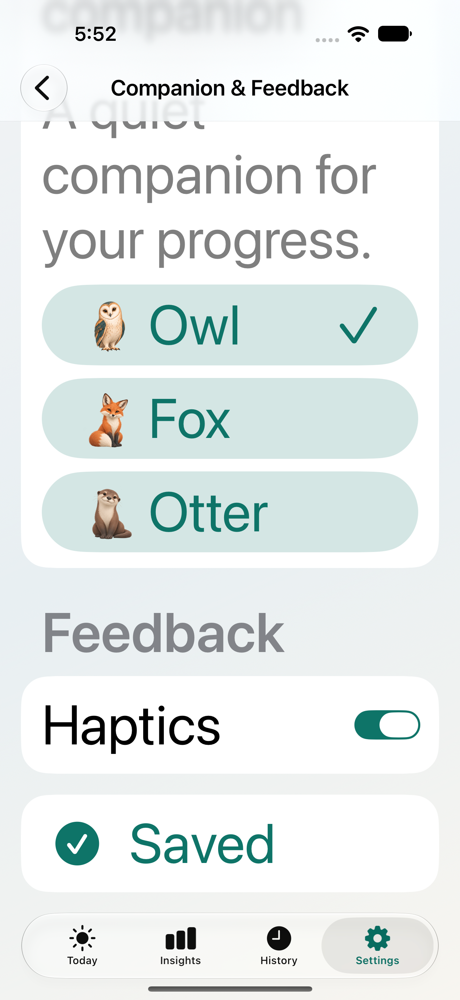

# Companion preference save feedback — October 21, 2026

The owner reported that Save Preferences appeared unresponsive even though the companion changed. The save already persisted; successful writes had no visible acknowledgment.

## Change

Settings → Companion & Feedback now changes the tapped button to a checkmarked **Saved** after the repository save returns successfully. VoiceOver receives “Preferences saved.” The screen stays open. Editing the animal, companion visibility or Haptics clears the old acknowledgment. A failed save preserves the draft and uses the existing generic error alert, without claiming success.

An initial confirmation row below Save passed interaction tests, but visual review found it could sit behind the floating tab bar at the largest text size. The final design puts confirmation in the button itself. The final native screenshot shows the entire Saved control above the tab bar:



This is transient presentation state. There are no schema, permission, dependency or data-handling changes. The existing settings-dismissal refresh for Today, widgets and Live Activities is preserved. No extra vibration, timer or navigation is added.

## Verification

- **15 CompanionTests passed**, including three new tests for successful persistence, clearing confirmation on every editable preference, write failure/retry and read failure. The profile's onboarding flag is preserved.
- **Two affected UI tests passed** on the isolated QA simulator: companion choice/visibility persistence through relaunch, and the largest-text Saved control's label, minimum height and position above the tab bar. Final screenshots were inspected visually.
- Final signed Debug iPhone build succeeded. The existing app was updated **in place**, launched through `devicectl`, and its app process was confirmed running. No uninstall, reset, fixture seeding or automated preference mutation was performed on the owner's phone.
- Scope is the affected tests and development installation. No full regression suite or Release build was rerun for this small presentation change. Real-device VoiceOver listening and the owner's save interaction remain manual checks.

The unchanged view-model logic passed in `/tmp/AvelaCodexMVP/Logs/Test/Test-Avela-2026.10.21_17-45-43--0600.xcresult`. The final button presentation passed in `/tmp/AvelaCodexMVP/Logs/Test/Test-Avela-2026.10.21_17-50-18--0600.xcresult`. These result bundles are local artifacts.

Final UI command:

```sh
DEVELOPER_DIR=/Applications/Xcode.app/Contents/Developer xcodebuild \
  -project Avela.xcodeproj -scheme Avela -configuration Debug \
  -destination 'platform=iOS Simulator,id=2ACFE418-44EC-4A44-9B2A-1B45BDF1EF38' \
  -derivedDataPath /tmp/AvelaCodexMVP -parallel-testing-enabled NO \
  CODE_SIGNING_ALLOWED=YES CODE_SIGN_IDENTITY=- \
  -only-testing:AvelaUITests/MVPFlowTests/testCompanionChoiceAndVisibilitySurviveRelaunch \
  -only-testing:AvelaUITests/MVPFlowTests/testCompanionSaveConfirmationIsReadableAtLargestTextSize test
```

The earlier unit selection was `-only-testing:AvelaTests/CompanionTests`, alongside the same two UI tests. All UI-test writes used the existing per-test isolated store helper; the owner's simulator was not used.

The phone build used the temporary iPhone-only project described in [first-device-build](../first-device-build/README.md); the repository's Watch target remains intact. Local build, install and launch evidence is under `/tmp/rilova-companion-feedback-device-final-build.log`, `/tmp/rilova-companion-feedback-install.*`, `/tmp/rilova-companion-feedback-launch.*` and `/tmp/rilova-companion-feedback-processes.*`. Device identifiers are not copied into this document. No archive, upload, commit or push was performed.
