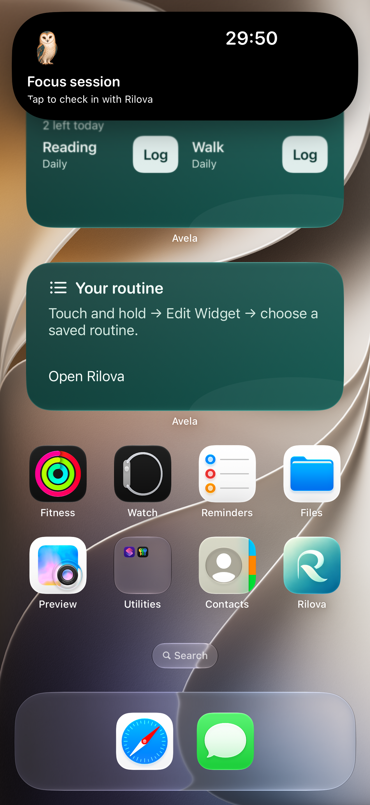

# Dynamic Island iPhone packaging correction — October 21, 2026

The owner started a Focus session through Habit Detail → Make Room with the mascot/timer toggle enabled, but no Dynamic Island appeared.

## Cause and correction

The repository project already declares boolean `NSSupportsLiveActivities = YES` in both Debug and Release. The temporary iPhone-only project had diverged: it omitted that setting and three existing privacy purpose strings (Health read, microphone and speech recognition). Inspection of the actual local product installed on the phone confirmed all four keys were absent. An earlier successful simulator run used the repository project and therefore did not catch the temporary project's divergence.

The temporary project has been regenerated from the current repository project in full. Structural comparison confirms that its only object differences are the app target's Watch dependency and Embed Watch Content arrays. All build configurations, other objects, capabilities, source and resource registrations match. The repository's Watch target remains intact. Future local builds must regenerate this temporary project from current source and validate the **built product**, rather than treating the temporary copy as a separate source of configuration.

No session-domain or Live Activity behavior changed. Existing running sessions remain persisted. Reconciliation still never creates an activity automatically; explicit Show can retry a session that was started before this packaging correction. Timer expiry cannot mark a session Kept or complete a habit. No permissions are requested by installing the corrected metadata.

## Regression coverage

`AppShellTests.testBundledSystemIntegrationConfigurationIsPresent` checks the running test host's actual Info.plist for boolean Live Activity support and all three nonempty purpose strings. The existing native Make Room UI flow now fails when an explicitly enabled Live Activity fails to start, instead of silently bypassing its Island inspection.

Tests use the corrected temporary phone project on the dedicated QA simulator. UI-test data remains isolated through the existing per-test store helper; the owner's simulator and iPhone are not used for automated test writes. The owner's real-device session is not restarted, finished or replaced by this investigation.

Apple's required Info.plist declaration is documented in [Displaying live data with Live Activities](https://developer.apple.com/documentation/activitykit/displaying-live-data-with-live-activities).

## Test evidence

- **21 unit tests passed:** three AppShellTests (including the new built-metadata regression) and 18 SessionLiveActivityServiceTests. The latter confirm failure/disabled presentation leaves sessions intact, original deadlines survive goal edits, system dismissal is respected and no outcome is inferred.
- **One native UI flow passed:** Make Room focus start with presentation explicitly enabled, native ActivityKit request, Home/expanded Dynamic Island, relaunch and independent habit logging. The screenshot was visually checked for the companion, countdown and Focus session label.
- No production Swift behavior, schema, entitlement or permission policy changed. MVP acceptance remains the existing explicit, time-bound focus/phone-free presentation. No full regression or Release build was run for this development-packaging correction.



This is a **simulator** screenshot from the corrected phone-project test build, not proof of the physical iPhone's display. Previously placed QA widgets retain cached Avela captions; the active app and Island copy show Rilova. No widget-gallery claim is made from that capture.

The native flow + AppShell result bundle is `/tmp/RilovaPhoneActivityQA/Logs/Test/Test-RilovaPhone-2026.10.21_17-58-05--0600.xcresult` (three units, one UI). The service-only follow-up is `/tmp/RilovaPhoneActivityQA/Logs/Test/Test-RilovaPhone-2026.10.21_18-00-52--0600.xcresult` (18 units). The initial service selection incorrectly included its filesystem subfolder, which matched no tests; it was rerun using the actual XCTest class identifier before reporting this count.

```sh
DEVELOPER_DIR=/Applications/Xcode.app/Contents/Developer xcodebuild \
  -project /tmp/RilovaPhoneDevice/Avela.xcodeproj -scheme RilovaPhone \
  -configuration Debug \
  -destination 'platform=iOS Simulator,id=2ACFE418-44EC-4A44-9B2A-1B45BDF1EF38' \
  -derivedDataPath /tmp/RilovaPhoneActivityQA -parallel-testing-enabled NO \
  CODE_SIGNING_ALLOWED=YES CODE_SIGN_IDENTITY=- \
  -only-testing:AvelaTests/AppShellTests \
  -only-testing:AvelaTests/SessionLiveActivityServiceTests \
  -only-testing:AvelaUITests/MVPFlowTests/testMakeRoomCreatesFocusSessionAndRequiresSeparateHabitLogging test
```

The service follow-up used the same destination/derived data and `test-without-building -only-testing:AvelaTests/SessionLiveActivityServiceTests`. Local logs: `/tmp/rilova-live-activity-package-tests.log` and `/tmp/rilova-live-activity-service-tests.log`.

## Signed iPhone update

The corrected signed Debug build succeeded using the temporary `RilovaPhone` scheme. Before installation, inspection confirmed `NSSupportsLiveActivities` is boolean true and all three purpose descriptions exactly match current repository Debug settings. Deep signature validation passed; app, widget and monitor signatures/provisioning profiles have the same development team and shared App Group. These checks inspect build products, not user record contents.

`devicectl` updated the existing app in place. No uninstall, reset, fixture seeding, session start or outcome reporting was performed on the iPhone. Build/install evidence: `/tmp/rilova-live-activity-device-build.log`, `/tmp/rilova-live-activity-install.*`; selected before/after metadata: `/tmp/rilova-live-activity-before-plist.json` and `/tmp/rilova-live-activity-after-plist.json`. Device identifiers remain in local tool artifacts only.

Automatic launch after this update was refused because the iPhone was locked (`FBSOpenApplicationErrorDomain`, Locked); installation itself succeeded. Unlock and open Rilova manually. No successful launch or on-device presentation is claimed for this update. Launch evidence is `/tmp/rilova-live-activity-launch.*`.

On the iPhone, open the existing active session through Make Room → Open Session & Check In (or its Attention goal), choose **Show Session Activity**, then go Home. There is no need to start a replacement session. iOS authorization and actual physical Island/Lock Screen presentation still require the owner's confirmation; simulator display and a successful install are not a physical-display result. TestFlight distribution and Family Controls approval remain separate release gates.
